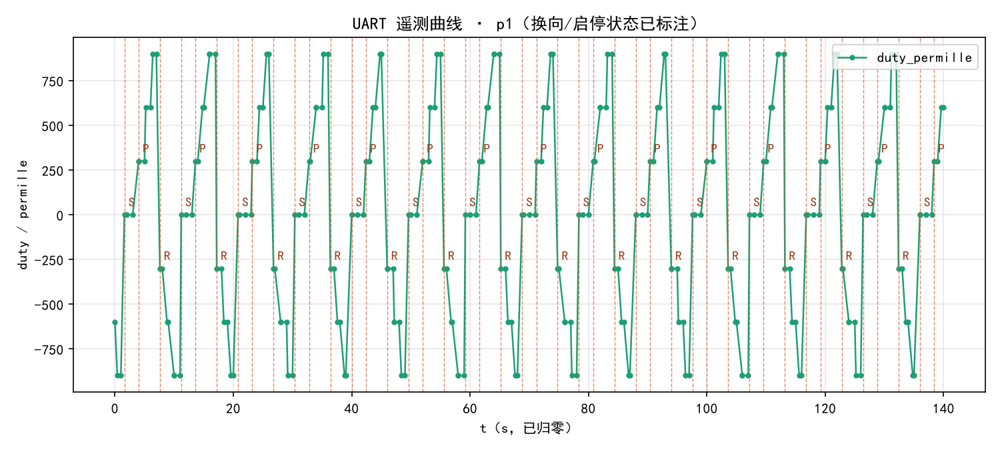

# dianji 工程 README

> 建工程日期：2026-10-17
> 状态：✅ **v0.2 已编译 + 反汇编验证**（USART1/printf 待真机接线确认，见第八节）
> 芯片：STM32F103C8T6 ｜ 时钟：HSE 8MHz → 72MHz（APB1 36MHz / APB2 72MHz）｜ Toolchain：CMake + GCC
> 占用：FLASH 18968 / 65536 B（28.9%）｜ RAM 2184 / 20480 B

**已验收的能力（全部真机验证，不是"应该能行"）：**

| 能力 | 验证方式 |
|---|---|
| TIM1_CH1 / PA8 输出 20.000 kHz PWM | 反汇编确认 `Period=3599 / Prescaler=0`；量 PA8 平均值 0→0.99→1.98→2.97V |
| PB0/PB1 方向切换 | 反汇编确认掩码 0x3，AIN 上电解 0 |
| PB5 = STBY 拉高 | 实测恒 3.3V |
| PC13 LED 心跳 | 每 1.2s 翻一次 |
| **PB8/PB9 软件 I2C + SSD1306 实时显示** | 反汇编确认 `Pin=0x300 / Mode=0x11(开漏)`；**屏幕 4 行显示正常** |
| **USART1 115200 8N1（v0.2）** | 反汇编确认 `__io_putchar` 为强符号 `T`、`_write` 为 weak `W`；PA9 `Pin=0x200 / Mode=2(AF_PP)`；BaudRate 立即数 `115200` 已入二进制 |

---

## 一、这个工程现在就能烧

```bash
export PATH="/c/Users/19780/.local/stm32cube/bin:/c/Users/19780/AppData/Local/stm32cube/bundles/gnu-tools-for-stm32/14.3.1+st.2/bin:$PATH"
cd /e/Demo/dianji
cube cmake --build build/Debug
```

产物：`build/Debug/dianji.elf`

**烧录**（接好 ST-Link，只接 SWDIO/SWCLK/GND 三根）：

```bash
export PATH="/c/Users/19780/.local/stm32cube/bin:$PATH"
cube programmer -c port=SWD --download build/Debug/dianji.elf --reset
```

> ⚠️ ST-Link 的三根线：**SWDIO(PA13) / SWCLK(PA14) / GND**。**绝对不要接 ST-Link 的 3.3V 脚** —— 它会和板上的 AMS1117 打架。

---

## 二、已经固化下来的 6 项配置

| 项 | 值 | 二进制里已验证 |
|---|---|---|
| HSE | 8MHz 晶振 | — |
| SYSCLK | 72 MHz（HSE ×9 / PLL） | `PLL.PLLMUL = RCC_PLL_MUL9` |
| APB1 | 36 MHz（÷2） | — |
| APB2 | 72 MHz（÷1） | — |
| **TIM1_CH1 / PA8** | Prescaler=**0**, Period=**3599** → **20.000 kHz** | ✅ `movw r2, #3599` + `[r3,#4]=0` |
| GPIO | PB0/PB1=AIN1/AIN2，PB5=STBY，PC13=LED | ✅ 掩码 `#3`(PB0\|PB1)、`#32`(PB5)、AIN 置 0、STBY 置 1 |

反汇编验证命令：

```bash
arm-none-eabi-objdump -d build/Debug/dianji.elf | awk '/<MX_TIM1_Init>:/,/^$/' | grep movw
```

---

## 三、电机没到也能做的三项静态验证

| # | 测什么 | 怎么做 | 预期 |
|---|---|---|---|
| 1 | **PWM 波形真出来了** | 万用表 DC 档量 **PA8** 对 GND 的平均电压 | +90% 时 ≈ **2.97V**；0% 时 **0.00V** |
| 2 | **AIN 极性对** | 按节奏量 PB0 / PB1 | `+` 档 `PB0=3.3V, PB1=0V`；`-` 档反过来 |
| 3 | **STBY 真被拉高** | 量 **PB5** | 恒 **3.3V** |

> ⚠️ 第 3 项是最省时间的一刀：**如果现在不查，电机到货那天你会以为是 TB6612 坏了，或者以为是电机坏了，或者以为是线断了。**

上电 1.2 秒后电机会走第一档（+30%），LED 每档翻一次。所以**看 LED 闪的节奏就知道现在在第几档**。

---

## 四、文件结构 —— 谁是谁

```
E:\Demo\dianji\
├── Core/
│   ├── Inc\
│   │   ├── config.h  ← ⭐ 参数总闸（改 PWM 频率/限幅/引脚全在这里）
│   │   ├── motor.h   ← 电机 API（往外只露"千分比速度"）
│   │   ├── usart.h   ← 串口 API（v0.2）
│   │   ├── main.h / gpio.h / tim.h / stm32f1xx_it.h / stm32f1xx_hal_conf.h
│   └── Src\
│       ├── motor.c   ← 驱动实现，含 4 个坑的对策
│       ├── usart.c   ← USART1 驱动 + __io_putchar（v0.2）
│       ├── main.c    ← 业务代码全在 3 处 USER CODE / USER CODE BEGIN Includes
│       ├── tim.c     ← TIM1 PWM 初始化
│       ├── gpio.c    ← GPIO 初始化（只管板级引脚，不含 PA9/PA10）
│       ├── stm32f1xx_hal_msp.c / stm32f1xx_it.c / syscalls.c / sysmem.c / system_stm32f1xx.c
├── Drivers/          ← STM32Cube_FW_F1 V1.8.7 的 HAL + CMSIS（含手动补回的 hal_uart.c/.h）
├── cmake/            ← STM32CubeMX 的 CMake 支持
├── CMakeLists.txt    ← ⭐ 根 CMakeLists（CubeMX 不会覆盖）：motor.c/OLED.c/display.c/usart.c/hal_uart.c 全加在这儿
├── CMakePresets.json
├── dianji.ioc        ← 工程配置（见下方第五节）
└── STM32F103xx_FLASH.ld / startup_stm32f103xb.s
```

**分层的意义**：调参数只改 `config.h`；加 CAN / 编码器 / PID 都在应用层加文件，**永远不碰 `motor.c`**。

---

## 五、关于 dianji.ioc（重要）

这个 `.ioc` 是**照着已经编译通过的源码反写**的，不是我凭空生成 —— 里面每一项都对应你现在这份代码的实际行为。

**你可以拿它做两件事**：

1. ✅ **用 CubeMX 打开，当作"图谱"看** —— 一目了然每个引脚配了什么
2. ⚠️ **在 CubeMX 里点 `Generate Code` 之前，先做两件事**：
   - 看芯片图上 **PA8 / PB0 / PB1 / PB5 / PC13 / PB8 / PB9 / PA9 / PA10 / PA13 / PA14 是否都在**（如果少了，说明 `.ioc` 某处没被完全解析，手动加上再生成）
   - 确认第二节表格与第八节（USART）的数值一致

**如果你 `Generate Code`，会发生什么**：CubeMX 会重写 `Core/Src/tim.c`、`gpio.c`、`main.c` 等；因为 `.ioc` 里没勾 USART1，它**还会把 `stm32_f1xx_hal_uart.c` 从 `STM32_Drivers_Src` 里删掉、把 `hal_conf.h` 的 `HAL_UART_MODULE_ENABLED` 再注释回去**。你的业务代码只要全在 `USER CODE BEGIN/END` 之间就**不会丢**，但 **v0.2 的串口会静默失效**。

> 防这个的办法已经在做了：宏和 `hal_uart.c` 都写在**根** `CMakeLists.txt`，CubeMX 覆盖不到，所以 USART1 照样能编进去。
> 但要记住：**如果你在 CubeMX 里勾了 USART1 再生成**，`cmake/stm32cubemx/CMakeLists.txt` 的 `STM32_Drivers_Src` 也会列出 `hal_uart.c`，两边重复 ⇒ 链接会报 `multiple definition of HAL_UART_Init`。这时把根 CMakeLists 里手动加的那行 `hal_uart.c` 删掉即可。

---

## 六、下一步（按依赖排序）

| 阶段 | 加什么 | 依赖 | 状态 |
|---|---|---|---|
| **✅ v0.1** | TIM1 PWM + 电机方向 + STBY + LED 心跳 | 无 | **已完成，已真机跑通** |
| **✅ v0.2** | USART1 + printf | 只需一块 C8T6 + USB-TTL | **已完成，已编译 + 反汇编验证，待接线确认** |
| **v0.3** | TIM3 编码器 4 倍频测速 | 电机到货 | 等 |
| **v0.4** | PID 速度环（10ms） | v0.2 + v0.3 | 等 |
| **v0.5** | CAN（`can_bsp.c`/`can_proto.c` 从 duoji 搬来） | 器件到齐 | 等 |

**v0.2 是最该马上做的一步** —— 没有串口，PID 就是盲调。

---

## 七、四个坑速查（全在 motor.c 注释里）

| # | 坑 | 现场表现 |
|---|---|---|
| ① | CCR 是 uint32_t，负值直写溢出 | 电机全速、正转、完全不受控 |
| ② | TIM1 是高级定时器，`HAL_TIM_PWM_Start` 不置 BDTR.MOE | 代码通了、寄存器对了、PA8 一片寂静 |
| ③ | TB6612 STBY 低电平休眠 | 电机不转、VM 有 12V、AO1/AO2 无输出 |
| ④ | Init 顺序：方向脚 → STBY → PWM | 上电瞬间电机"咯噔"抖一下 |

---

## 八、USART1 串口怎么用（v0.2）

### 1. 接线（3 根，只接 3 根）

| STM32F103 | 接 | 说明 |
|---|---|---|
| **PA9**（TX） | USB-TTL 模块的 **RX** | 单向只看输出的话只接这根 + GND |
| **PA10**（RX） | USB-TTL 模块的 **TX** | 要发命令回显才接 |
| **GND** | USB-TTL 的 **GND** | ⭐ **必须共地**，不共地一个字节都收不到 |

> ⚠️ USB-TTL 模块默认多是 5V 供电，但它的 TX/RX 通常是 3.3V 电平输出、可容忍 5V 输入。**PA9/PA10 不是 5V 容忍脚**——如果模块的 TX 引脚直接输出 5V 高电平，会在 PA10 上形成倒灌风险。稳妥做法是 USB-TTL **也用 3.3V 供电**（CH340 模块上有 3V3/5V 跳线，跳到 3V3）。

### 2. 串口助手设置

**波特率 115200 ｜ 数据位 8 ｜ 停止位 1 ｜ 校验 None ｜ 流控 None**

### 3. 输出长什么样

```
# dianji v0.2 | NODE 1 | SYSCLK 72M APB2 72M | PWM 20kHz ARR 3599
# USART1 PA9(TX) 115200 8N1  RX=PA10  接线: STM32 PA9 -> USB-TTL 的 RX
# duty_permille: 1000 = 100%占空比;  dir: P=正转 R=反转 S=停止
t_ms,duty_permille,dir
0,0,S
1200,300,P
2400,600,P
3600,900,P
4800,-300,R
...
10004,0,S        ← 1 秒心跳（duty 没变也打，证明设备还活着）
```

前 3 行 `#` 开头是给人看的，**第 4 行 `t_ms,duty_permille,dir` 开始才是给 Excel 的数据**。

**导 Excel**：串口助手另存成 `.txt` → Excel「数据 → 自文本/从文本」→ 分隔符选**逗号** → 导入起点选在 `t_ms` 那一行。

### 4. 打印节奏的设计理由

| 触发 | 频率 | 为什么 |
|---|---|---|
| duty 变化 | 每 1.2s（= `MOTOR_DEMO_STEP_MS`） | Excel 里能看到干净的阶跃点 |
| 1 秒心跳 | 每 1000ms | 设备活着；万一主循环跑飞你能立刻看出"时间戳停了" |

一行约 12 字节 ≈ **1.0ms @115200**，占主循环比例可忽略，所以**没有**用定时器中断发串口（那会挤掉将来的 PWM 控制周期）。

### 5. 这里也有 3 个静默失败点

| # | 坑 | 现场表现 |
|---|---|---|
| ① | **没清 ORE** | TX 完全正常，RX 第一次溢出后永不再置位，串口"假死"，你会以为线断了 |
| ② | **`__io_putchar` 写成 weak** | `syscalls.c` 里的 weak 版赢过你的实现，printf 全丢，编译链接都不报错 |
| ③ | **没设 `setvbuf(stdout, NULL, _IONBF, 0)`** | newlib 行缓冲把 `'\r'` 之后的半行憋住，表现为"隔一会儿才冒出一行" |

### 6. `strlen` 的 `#include <string.h>`

`usart.c` 里用了 `strlen`，必须有 `#include <string.h>`。缺了编译器只给 warning，链接会报 undefined —— 但如果在 `--specs=nano.specs` 下，符号被改名成 `_strlen`，报错信息会变得很难认。

---

## 九、CAN 总线 + PC 上位机（can v0.2，真机已通）

### 1. 固件侧

| 文件 | 职责 |
|---|---|
| `Core/Inc/can_proto.h` + `Core/Src/can_proto.c` | 应用层协议：8 字节帧（0xA0\|L 帧头兼长度 / seq / cmd / 小端载荷 / CRC-8/SMBUS），组包·解包·序号丢帧统计 |
| `Core/Inc/can_bsp.h` + `Core/Src/can_bsp.c` | bxCAN 硬件层：500 kbps 位时序、ID 滤波器、FIFO0 接收中断 |

真机链路统计（串口周期打印）：`tx=1390 rx=1390 ok=1390 crc=0 gap=0 fail=0` —— 收发零错误。

### 2. PC 上位机

`tools/can_host.py`（约 780 行，无第三方依赖框架，仅 python-can）：

- 协议常量与 `can_proto.h` 逐项对齐（两边一起改，注释里写死了这条纪律）
- 命令：PING / SET_SPEED（千分比）/ STOP / GET_STAT，fire-and-forget 命令配合 GET_STAT 回读确认
- `selftest` 子命令：无硬件时在 python-can 虚拟总线上完成全流程自测
- 遥测数据可落盘 CSV，配合 Excel/脚本画响应曲线



*140 秒真机遥测：换向/启停状态变化已标注；同期链路统计 1390 帧 0 错误*

### 3. 协议速览

```
字节   0        1     2      3..6            7
      0xA0|L   seq   cmd    payload(小端)    CRC-8/SMBUS(poly 0x07)
CAN ID：0x100+node = 命令帧（PC→板）；0x200+node = 应答帧（板→PC）
```
